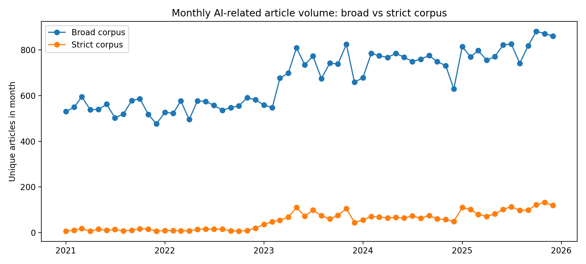

# Tracing the AI Narrative：Guardian ai news analysis

How has artificial intelligence been covered in the news? This project analyzes *The Guardian’s* AI reporting from 2021 to 2025, examining article volume, editorial sections, and recurring themes through text classification, topic modeling, and interactive visualizations.

Broad keyword searches often retrieve incidental mentions of AI alongside articles about AI itself. The project addresses this problem by combining relevance filtering with a saved article audit to construct a focused corpus. It then explores where AI stories appear across the newsroom and whether article text and metadata can predict Technology/Business section membership.

## What the analysis found

- **A more focused corpus:** 40,232 broad search results were narrowed to 3,120 AI-focused articles. In the saved relevance audit, 80 of 100 strict-corpus articles were labeled core AI, compared with 1 of 100 articles excluded by the strict filter.
- **AI coverage extends across the newsroom:** The strict corpus spans 39 editorial sections, and 53.3% of articles appeared outside Technology and Business. This shows that relevant reporting also appears in areas such as opinion, world news, books, and film.
- **Coverage grew, with fluctuations:** Strict-corpus counts increased from 138 articles in 2021 to 1,229 in 2025. Growth was uneven: the count fell from 846 in 2023 to 769 in 2024.
- **Text captures patterns in editorial placement:** XGBoost achieved 76.4% accuracy, 0.750 F1, and 0.847 ROC-AUC on a retrospective holdout, compared with 53.4% accuracy for a majority baseline. Six exploratory LDA topic groups offer a complementary view of recurring language.

Together, these results illustrate why relevance filtering matters when studying AI news and show the breadth of AI coverage across a single publisher. Section membership is a proxy for editorial placement, rather than a directly measured substantive frame; the analysis does not establish what caused coverage to change.



## Methods and materials

The workflow combines a query-defined corpus from the Guardian Content API, rule-based relevance filtering, a 200-article audit, TF-IDF text and metadata features, classification models, six-topic LDA, and Plotly charts. Section names are excluded from the predictors because they define the classification target.

The [full report](report.qmd) describes the methods, findings, and limitations. The repository includes analysis scripts, aggregate results, static figures, audit labels, and a pre-rendered Quarto website in `docs/`. Raw article text is not distributed; [data documentation](data/README.md) explains the local input format and source rights.

## Run locally

Use Python 3.11+ and [Quarto](https://quarto.org/docs/get-started/). Dependencies were verified with Python 3.13.

```bash
python3 -m venv .venv
source .venv/bin/activate
python -m pip install -r requirements.txt
bash build.sh
```

The default build refreshes charts and report tables from committed aggregate results and renders the website into `docs/`. Run `quarto preview` to browse it locally.

To rerun corpus preparation and text models, provide an authorized local dataset at `data/raw/guardian_ai_articles_broad.csv`, then run:

```bash
# Optional: include XGBoost in the model comparison
python -m pip install -r requirements-models.txt
bash build.sh --analysis
```

Raw data, per-article outputs, credentials, and local environments are excluded from version control. A validation run with the pinned dependencies reproduced the 3,120 strict article IDs, model metrics, topic keywords, and monthly topic weights.

## Scope and limitations

The results describe one publisher and a query-defined corpus, not all news or AI’s share of all Guardian reporting. The saved audit is small and lacks independent reviewer verification. Model selection used test-set F1, so the reported comparison is exploratory rather than a future-time forecast. Topic labels are heuristic and overlapping.

Source: [The Guardian Content API](https://open-platform.theguardian.com/documentation/). Article content remains subject to the [Guardian Open Platform terms](https://www.theguardian.com/open-platform/terms-and-conditions).
