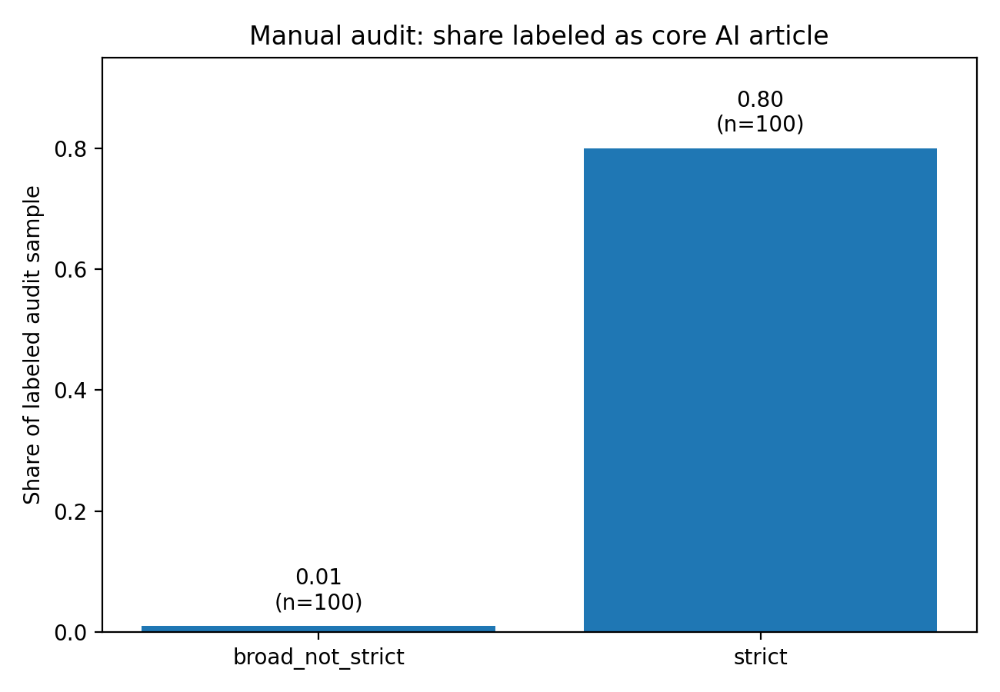
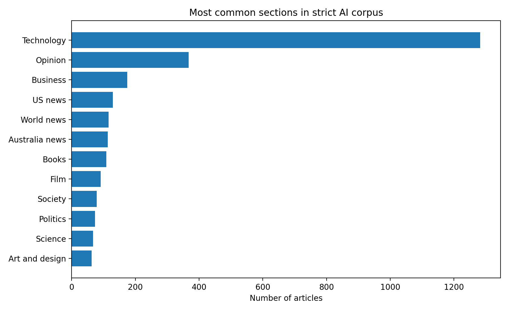
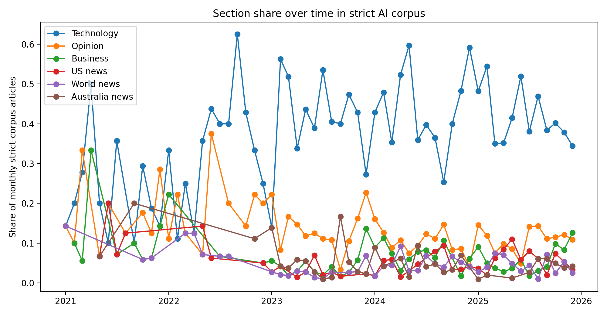
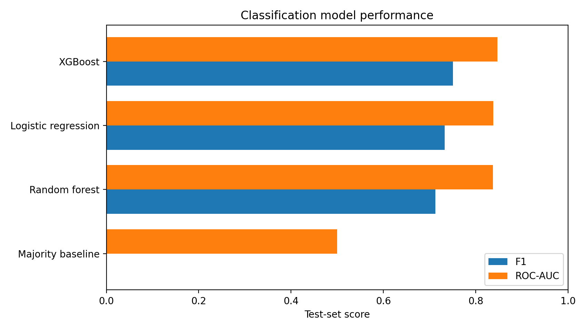
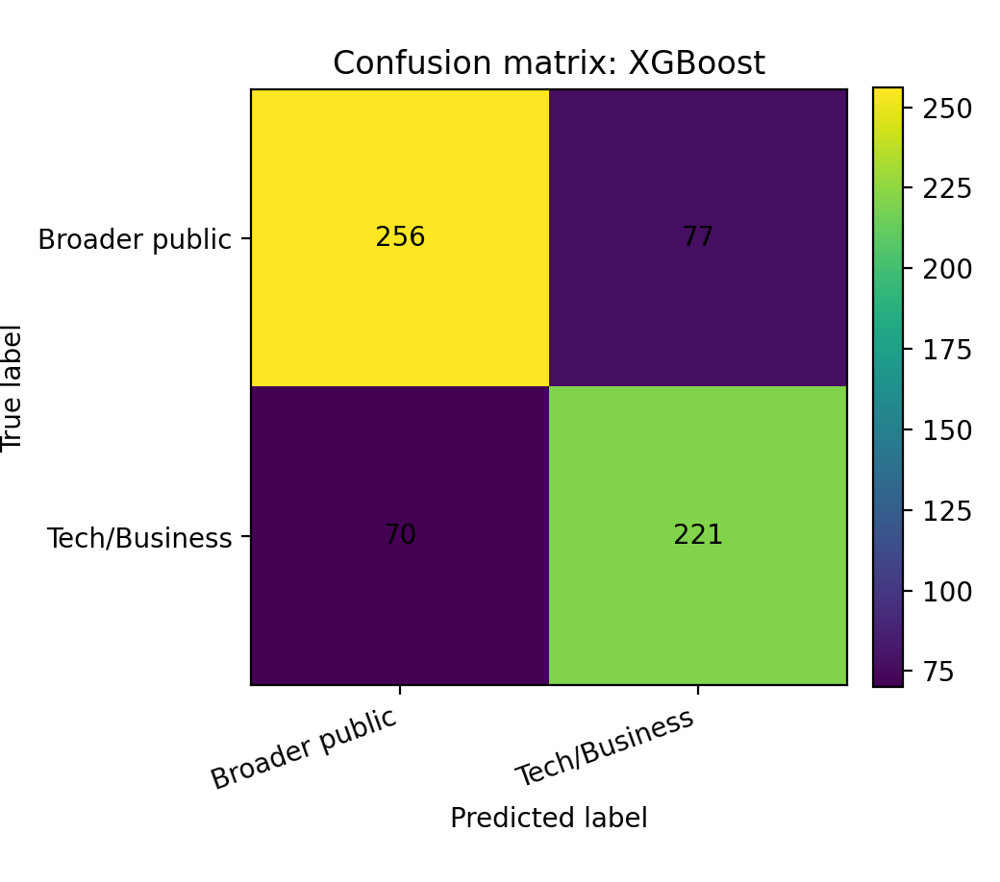
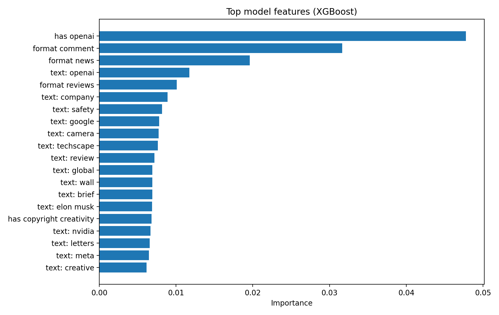
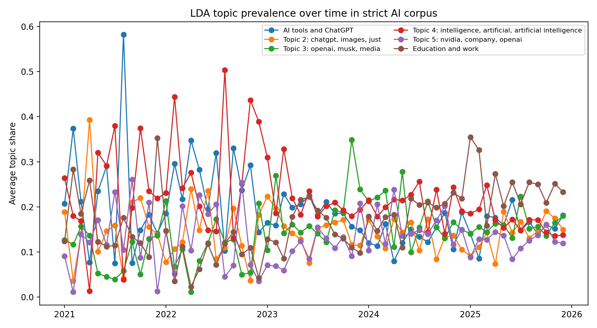

# Introduction

Artificial intelligence appears in reporting about technology, business, education, politics, creative industries, and everyday life. Studying where these articles are published and which words recur provides a descriptive view of how a news organization covers the subject.

This project examines *The Guardian's* AI-related reporting from January 2021 through December 2025. It combines a broad search corpus, a stricter relevance filter, a saved relevance audit, section-based classification, and topic modeling.

The research question is:

> How did the volume and section distribution of retrieved AI-related articles change, and how well can article text and metadata predict Technology/Business section membership?

The study describes coverage within a query-defined corpus. It does not estimate AI's share of all Guardian reporting, identify causal effects, or measure readers' responses.

# Data and methods

## Corpus construction

The source is the [Guardian Content API](https://open-platform.theguardian.com/documentation/). Articles were retrieved month by month for 2021–2025 using general AI terms, technical terms, and names associated with generative AI. Search terms include artificial intelligence, machine learning, generative AI, large language model, ChatGPT, deep learning, neural network, LLM, OpenAI, Google Gemini, Google DeepMind, Claude AI, DALL-E, and Midjourney.

The broad corpus is the deduplicated union of these search results. A strict subset retains articles with strong AI signals in keyword tags or headline and summary text. Standalone “AI” is excluded from the broad query and considered with relevant context in the stricter matching rules. Articles are deduplicated using their Guardian IDs.

The saved corpus contains **40,232 broad-search articles** and **3,120 strict articles** across **60 months**. The strict corpus is **7.76%** of the broad corpus. Both datasets have unique article IDs; all strict articles have headline and summary text.

The public repository contains aggregate outputs and audit labels. Article text is excluded. Rerunning corpus preparation or text models requires an authorized local dataset. Source access and use are subject to the [Guardian Open Platform terms](https://www.theguardian.com/open-platform/terms-and-conditions).

## Relevance audit

The saved audit contains 100 strict-corpus articles and 100 broad-but-not-strict articles. Labels distinguish `core_ai_article`, `incidental_ai_mention`, and `unclear`, based on the headline and summary. The audit compares the sampled groups; it does not establish the recall of the strict filter against all AI coverage.

The label file records **80 core AI articles in the strict sample** and **1 in the broad-but-not-strict sample**. The remaining articles are labeled incidental. Reviewer identity and independent verification are not recorded, so these figures summarize the supplied audit labels.

## Classification task

The target is `tech_business_frame`:

- **1:** an article appears in Technology or Business.
- **0:** an article appears in any other section.

The variable name refers to an operational proxy. The task predicts section membership, rather than a human-coded substantive frame. An article outside Technology or Business can still discuss technical or commercial issues, and the reverse is also possible.

Features combine headline and summary TF-IDF unigrams and bigrams with publication time, word counts, tag counts, keyword indicators, editorial-format indicators, and VADER sentiment. Section name is excluded from predictors because it defines the target. Text vectorization and numeric preprocessing are fitted within the training pipeline.

The model comparison includes a majority-class baseline, logistic regression, random forest, and XGBoost when installed. An 80/20 stratified random split produces 2,496 training articles and 624 test articles. Accuracy, precision, recall, F1, and ROC-AUC are calculated on the test set; precision, recall, and F1 use Technology/Business as the positive class.

The displayed model is selected by test-set F1. There is no separate model-selection validation set or future-time holdout, so the comparison is exploratory. Original package versions were not recorded, and the committed scores represent a saved analysis snapshot.

## Topic model

A six-topic latent Dirichlet allocation model uses word and phrase counts from strict-corpus headlines and summaries. Monthly topic prevalence is the mean document-topic weight in each month. Every article can contribute weight to multiple topics.

Topic labels are assigned using keyword matching and fallback descriptions of high-weight terms. These labels aid inspection; they are not validated categories. The six-topic choice and short source texts constrain how much thematic detail the model can recover.

# Results

## Article volume and editorial placement

The strict corpus contains **1,457 Technology/Business articles (46.7%)** and **1,663 articles in other sections (53.3%)**, distributed across **39 sections**. This establishes that the retrieved AI-focused articles appear across a range of editorial sections. It does not by itself establish a shift in substantive framing over time.

| Year | Strict articles |
|:--|--:|
| 2021 | 138 |
| 2022 | 138 |
| 2023 | 846 |
| 2024 | 769 |
| 2025 | 1,229 |

The strict-corpus count is substantially higher in 2025 than in 2021, with a decrease in 2024 relative to 2023. Counts depend on search terms and relevance rules. Without a denominator for all Guardian articles, they do not measure the proportion of total reporting devoted to AI.

{width=70%}

The strict sample has a larger share labeled core AI than the broad-but-not-strict sample. Its 20 incidental labels also show that the strict filter does not eliminate irrelevant or peripheral results.

{width=95%}

{width=90%}

Technology is the largest individual section, with 1,282 articles (41.1%). Opinion contributes 367 articles (11.8%) and Business contributes 175 (5.6%). Other sections include US news, World news, Australia news, Books, Film, Society, and Politics.

{width=95%}

Section shares vary over time. Early months have small strict-corpus counts, making their proportions sensitive to individual articles. These descriptive changes do not identify the events or editorial decisions responsible for them.

## Classification comparison



The saved XGBoost result has the highest test F1 among compared models: **accuracy 0.764, precision 0.742, recall 0.759, F1 0.750, and ROC-AUC 0.847**. The majority-class baseline achieves **0.534 accuracy**. This indicates that text and metadata contain predictive information about section membership in this retrospective split.

{width=85%}

{width=70%}

The confusion matrix shows both kinds of section-membership error. These errors should not be interpreted as incorrect judgments about an article's substantive framing, because reference labels come from editorial sections.

{width=90%}

High-ranked saved features include the OpenAI indicator, editorial-format flags, and terms such as “openai” and “company.” Feature importance describes the fitted model's use of predictors; it does not show that these features cause an article to appear in a particular section.

## Topic words and monthly weights



The topic word groups include references to AI tools, ChatGPT and images, OpenAI and media, general AI discussion, companies, and work. Several groups share common AI terms, and some labels are broader than their top words alone support. They are best used to inspect the corpus alongside the keyword table, rather than as a fixed taxonomy of AI reporting.

{width=95%}

The chart tracks changes in mean model-estimated topic weight. A value of 0.20 means that the topic receives an average of one fifth of each document's topic weight that month; it does not mean exactly one fifth of articles belong exclusively to that topic. The [interactive chart page](viz.html) displays a trailing three-month rolling mean, with raw monthly values available on hover.

# Discussion and limitations

The retrieved strict corpus has much greater volume near the end of the study period than at its beginning. It also includes substantial reporting outside Technology and Business. Text and metadata predict section membership better than a majority baseline in the saved split, while topic words offer an exploratory view of recurring language.

Several limits shape these conclusions. The study covers one publisher and depends on query selection and relevance rules. Its small saved audit does not establish a complete gold-standard corpus, and reviewer provenance is unavailable. Section-derived labels do not directly measure substantive framing. A random split mixes earlier and later articles, and selecting the displayed model by test F1 can make that selected result optimistic. The analysis relies on short headline and summary text, sentiment is a coarse feature, and LDA labels describe overlapping word groups.

Future work could compare publishers, build an independently labeled framing dataset, assess relevance with a larger documented audit, and evaluate models on later publication periods. Testing topic stability and reporting uncertainty in monthly estimates would also strengthen the analysis. The current results remain descriptive and predictive; they do not establish causes of coverage changes or effects on public opinion.
